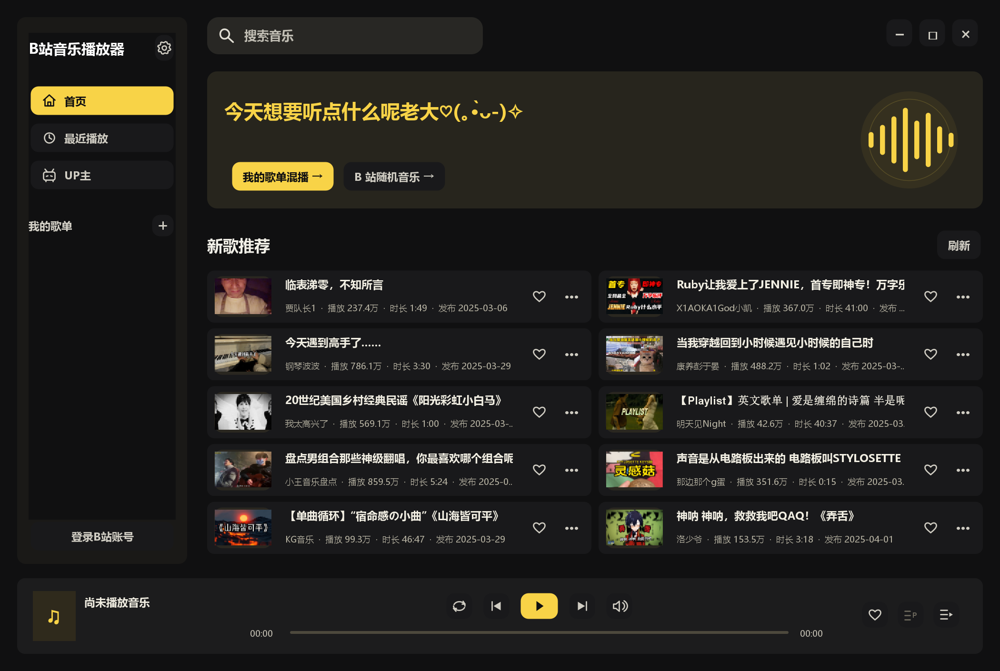
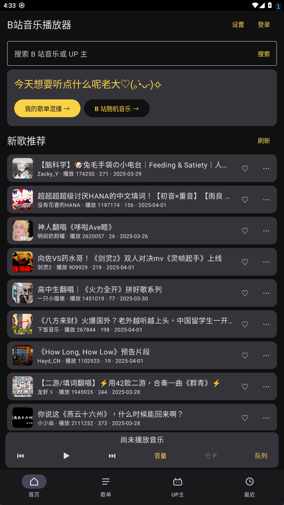

# B 站音乐播放器

在应用里搜索 B 站音乐、听歌和整理收藏夹。

## 功能

- 搜索视频和 UP 主，播放音轨，查看分 P 和播放队列。
- 扫码登录，导入 B 站收藏夹，查看指定关注分组。
- 音乐推荐、随机播放、最近播放和三套主题。
- 桌面端支持导入合集、合集随机播放和批量入队。

## 平台

| 平台 | 说明 |
| --- | --- |
| Windows | 桌面版 |
| Linux | 桌面版，需要图形桌面、Java 和 FFmpeg |
| Android | 支持 Android 8.0 及以上 |
| Web、iOS | 基础版，支持 BV 链接播放、本地歌单和最近播放 |

## 免责声明

本项目与哔哩哔哩无关。视频和音频版权归原权利人所有。请遵守平台服务条款及当地法律。平台接口变动或限制可能影响功能，应用按现状提供。
